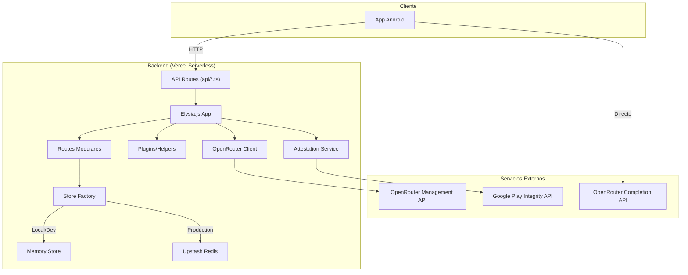

# Arquitectura General

Este backend actúa como **intermediario de seguridad** entre una aplicación Android y la API de OpenRouter. Su objetivo principal es garantizar que solo aplicaciones verificadas (mediante atestación de Google) puedan obtener claves de API de OpenRouter, sin que la clave maestra (`Management Key`) nunca llegue al cliente.

## Diagrama de Componentes



## Stack Tecnológico

| Capa | Tecnología | Propósito |
|------|-----------|-----------|
| **Runtime** | Bun.js | Motor JavaScript de alto rendimiento |
| **Framework** | Elysia.js | Web framework ligero con validación integrada |
| **Serverless** | Vercel Functions | Deploy serverless con routing automático |
| **Storage** | Upstash Redis | Persistencia distribuida en producción |
| **Auth** | Jose (JWT) | Firma y verificación de session tokens |
| **Attestation** | Google Play Integrity API | Verificación de integridad del dispositivo |
| **Key Management** | OpenRouter Management API | Creación y revocación de claves |

## Estructura de Archivos

```
EdgeBackend/
├── api/                          # Entry points para Vercel Serverless
│   ├── [...all].ts               # Catch-all route
│   ├── v1/
│   │   ├── challenge.ts          # POST /challenge
│   │   ├── session/issue.ts      # POST /session/issue
│   │   ├── openrouter/
│   │   │   ├── lease.ts          # POST /openrouter/lease
│   │   │   └── revoke.ts         # POST /openrouter/revoke
│   │   ├── health.ts             # GET /health
│   │   └── cron/reconcile.ts     # GET /cron/reconcile
├── src/
│   ├── app.ts                    # Orchestrator: ensambla rutas y plugins
│   ├── server.ts                 # Entry point (Bun.listen)
│   ├── config.ts                 # Variables de entorno y configuración
│   ├── types.ts                  # Tipos TypeScript compartidos
│   ├── schemas.ts                # Schemas de validación Elysia (centralizado)
│   ├── container.ts              # Instancias singleton (store, openRouterClient)
│   ├── auth/
│   │   └── sessionToken.ts       # Creación y verificación de JWTs
│   ├── routes/                   # Handlers por endpoint (modular)
│   │   ├── health.ts             # GET /health (con checks reales)
│   │   ├── challenge.ts          # POST /challenge
│   │   ├── session.ts            # POST /session/issue
│   │   ├── openrouter.ts         # POST /openrouter/lease + /revoke
│   │   └── cron.ts               # GET /cron/reconcile
│   ├── plugins/                  # Funciones helper reutilizables
│   │   ├── auth.ts               # requireSession + validateInstallOwnership
│   │   └── rateLimit.ts          # applyRateLimit
│   ├── services/
│   │   ├── openrouter.ts         # Cliente HTTP para Management API
│   │   ├── attestation.ts        # Verificación de Play Integrity
│   │   ├── store.ts              # Implementación en memoria
│   │   ├── upstashStore.ts       # Implementación en Redis
│   │   └── storeFactory.ts       # Selector de store según config
│   └── utils/
│       ├── crypto.ts             # Hashing y comparación segura
│       ├── id.ts                 # Generación de IDs únicos
│       ├── network.ts            # Helpers HTTP (bearer token, client IP)
│       └── errors.ts             # Clase HttpError personalizada
├── context_android/              # Código cliente Android (referencia)
│   ├── AppIntegrityService.ts    # Solicitud de tokens Play Integrity
│   └── KeyBrokerClient.ts        # Cliente HTTP para este backend
└── docs/                         # Esta documentación
```

## Variables de Entorno Principales

```bash
# Seguridad
JWT_SIGNING_SECRET=              # Clave para firmar session tokens (HS256)
CRON_SECRET=                     # Token para autenticar el cron job

# OpenRouter
OPENROUTER_MANAGEMENT_KEY=       # Clave maestra (nunca expuesta al cliente)
OPENROUTER_MANAGEMENT_BASE_URL=  # https://openrouter.ai/api/v1
OPENROUTER_KEY_NAME_PREFIX=      # Prefijo del nombre de key (default: r2p)
OPENROUTER_KEY_LIMIT=            # Límite de créditos por key (default: 10)
OPENROUTER_KEY_LIMIT_RESET=      # daily | weekly | monthly (default: daily)
OPENROUTER_INCLUDE_BYOK_IN_LIMIT= # Incluir BYOK en límite (default: false)
OPENROUTER_REQUEST_TIMEOUT_MS=   # Timeout de requests a OpenRouter (default: 7000)
OPENROUTER_EXTRA_CREATE_PAYLOAD= # JSON extra para creación de keys (default: {})
KEY_HARD_EXPIRES_SECONDS=        # Expiración local de la lease (default: 86400)
KEY_ROTATE_AFTER_SECONDS=        # Recomendación de rotación (default: 21600)

# Play Integrity (Android)
ENABLE_STRICT_ATTESTATION=       # true | false (default: true)
PLAY_INTEGRITY_PACKAGE_NAME=     # com.tuapp.android
PLAY_INTEGRITY_SERVICE_ACCOUNT_JSON=  # JSON inline de la cuenta de servicio
PLAY_INTEGRITY_ALLOWED_DEVICE_VERDICTS=  # MEETS_DEVICE_INTEGRITY,MEETS_STRONG_INTEGRITY
PLAY_INTEGRITY_REQUIRE_LICENSED= # Requiere licencia (default: true)

# Storage
UPSTASH_REDIS_REST_URL=          # URL de Upstash (opcional)
UPSTASH_REDIS_REST_TOKEN=        # Token de Upstash (opcional)
```

## Patrón de Diseño: Key Broker / Token Leasing

El backend implementa el patrón **Key Broker** (también llamado Token Leasing):

1. El backend crea una clave temporal mediante la Management API
2. La app recibe la clave y la usa **directamente** contra OpenRouter
3. El backend solo revoca/renueva claves cuando es necesario

Esto reduce la latencia (evita un salto extra) y descarga al backend del tráfico de inferencia.

**Referencia:** `src/app.ts:10-40` — definición de la app Elysia con manejo de errores y agrupación de rutas.

## Almacenamiento Dual

El backend soporta dos modos de almacenamiento seleccionados automáticamente:

- **Memory** (`src/services/store.ts:33`): Mapas en memoria. Rápido pero volátil. Ideal para desarrollo local.
- **Redis** (`src/services/upstashStore.ts:39`): Upstash Redis REST. Persistente y distribuido. Recomendado para producción.

El selector está en `src/services/storeFactory.ts:6-16`.

## Modularización

La aplicación está desagregada en **módulos independientes**:

- **Routes** (`src/routes/*`): Cada archivo expone un `new Elysia()` con sus endpoints
- **Plugins** (`src/plugins/*`): Funciones helper reutilizables (auth, rate limiting)
- **Container** (`src/container.ts`): Instancias singleton compartidas (store, clientes HTTP)
- **Schemas** (`src/schemas.ts`): Validaciones de Elysia centralizadas

**Referencia:** `src/app.ts:10-40` — orchestrator principal.
