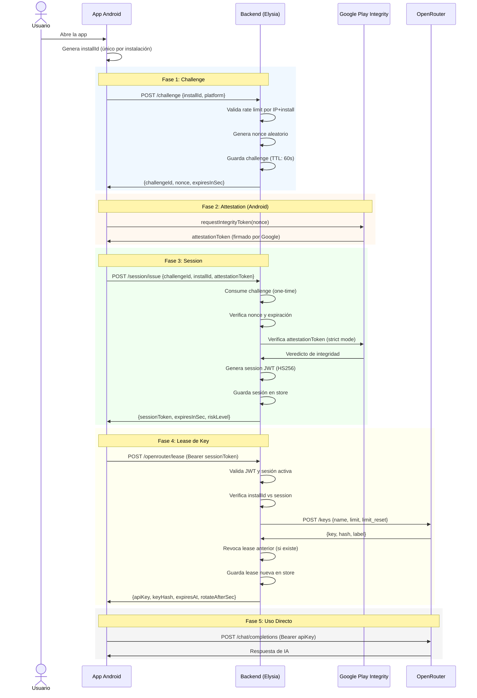

# Flujo de Seguridad y Datos

Este documento describe el flujo completo de autenticación y autorización desde que la app Android solicita acceso hasta que obtiene una clave de OpenRouter.

## Diagrama de Secuencia Completo

## Fases Detalladas

### 1. Challenge (`POST /challenge`)

**Propósito:** Prevenir ataques de repetición (replay attacks) vinculando una solicitud a un `nonce` único.

**Flujo:**
1. La app envía su `installId` + plataforma
2. El backend genera un `nonce` aleatorio (`src/utils/crypto.ts`)
3. Guarda el challenge con TTL de 60 segundos (`config.ts:130`)
4. Retorna el `challengeId` y el `nonce`

**Rate limit:** `RATE_LIMIT_CHALLENGE_PER_MIN` (default: 20) por IP + install hash.

**Referencia:** `src/routes/challenge.ts:13-51`

### 2. Attestation (Android)

**Propósito:** Probar que la app es legítima y no ha sido modificada.

**Flujo:**
1. La app usa la librería `@expo/app-integrity` para solicitar un token a Google
2. Google Play Integrity verifica:
   - El APK está firmado correctamente
   - El dispositivo no está rooteado (según política)
   - El nonce coincide con el challenge
3. Retorna un JWT firmado por Google

**En iOS:** Si `strictMode` está activo pero no hay `verifierUrl`, la app usa un token de debug.

**Referencia cliente:** `context_android/AppIntegrityService.ts:72-93`

### 3. Session (`POST /session/issue`)

**Propósito:** Convertir la atestación en un session token JWT de corta duración.

**Validaciones del backend:**
1. Consume el challenge (`brokerStore.takeChallenge`) — **solo se puede usar una vez**
2. Verifica que el challenge no haya expirado
3. Verifica que el `installId` y plataforma coincidan
4. Valida el attestation token:
   - Si `ENABLE_STRICT_ATTESTATION=false`: pasa automáticamente (`src/services/attestation.ts:526-532`)
   - Si `ENABLE_STRICT_ATTESTATION=true`: verifica con Google Play Integrity API (`src/services/attestation.ts:324-482`)
5. Emite un JWT firmado con `JWT_SIGNING_SECRET` (algoritmo HS256)

**Claims del JWT:**
- `jti`: ID único de sesión
- `sub`: hash del installId
- `platform`: android | ios
- `riskLevel`: low | medium | high
- `iat` / `exp`: timestamps

**TTL:** 15 minutos (`SESSION_TTL_SECONDS=900`)

**Referencia:** `src/routes/session.ts:14-90`, `src/auth/sessionToken.ts`

### 4. Lease de Key (`POST /openrouter/lease`)

**Propósito:** Crear una clave de OpenRouter temporal para esta instalación.

**Flujo:**
1. Valida el Bearer session token
2. Verifica que el `installId` pertenezca a la sesión
3. Si ya existe una lease activa para este install:
   - La revoca upstream (desactiva en OpenRouter)
   - La marca como revocada localmente
4. Crea una nueva key en OpenRouter vía Management API
5. Guarda la lease con TTL local

**Restricciones de la key creada:**
- `limit`: créditos máximos (default $10)
- `limit_reset`: recuento de créditos (`daily`/`weekly`/`monthly`)
- Expiración local: `KEY_HARD_EXPIRES_SECONDS` (default 24h)

**Referencia:** `src/routes/openrouter.ts:12-98`, `src/services/openrouter.ts:116-151`

### 5. Uso Directo y Revocación

La app usa la `apiKey` recibida directamente contra `https://openrouter.ai/api/v1/chat/completions`.

El backend puede revocar la key:
- **Manualmente:** `POST /openrouter/revoke` (llamado desde la app)
- **Automáticamente:** Cron job `/cron/reconcile` que desactiva keys expiradas

**Referencia:** `src/routes/openrouter.ts:99-136` (revoke), `src/routes/cron.ts:8-37` (cron)

## Modelo de Amenazas

| Amenaza | Mitigación |
|---------|-----------|
| Replay de challenge | Challenges de un solo uso (`takeChallenge` elimina el registro) |
| Token de attestation robado | Vinculación estricta installId + nonce + timestamp |
| Clave maestra expuesta | Nunca sale del backend; solo se usan keys derivadas |
| Key leaseada robada | TTL corto + límite de créditos + revocación manual |
| Peticiones masivas | Rate limits por endpoint (challenge, session, lease) |
| App clonada / modificada | Play Integrity verifica firma del APK y estado del dispositivo |
| JWT de sesión robado | Expiración corta (15min) + validación de revocación en store |

## Referencias de Código Clave

| Concepto | Archivo | Líneas |
|----------|---------|--------|
| Generación de nonce | `src/utils/crypto.ts` | — |
| Hash de installId | `src/utils/crypto.ts` | — |
| Rate limiting | `src/plugins/rateLimit.ts` | — |
| Validación de attestation | `src/services/attestation.ts` | 515-547 |
| Verificación Play Integrity | `src/services/attestation.ts` | 324-482 |
| Creación de session JWT | `src/auth/sessionToken.ts` | 30-46 |
| Verificación de session JWT | `src/auth/sessionToken.ts` | 48-80 |
| Creación de key OpenRouter | `src/services/openrouter.ts` | 116-151 |
| Revocación de key | `src/services/openrouter.ts` | 153-157 |
