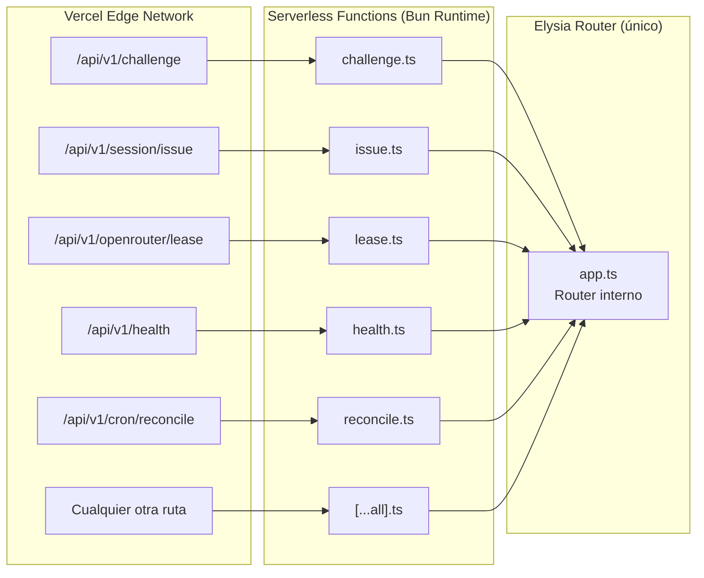
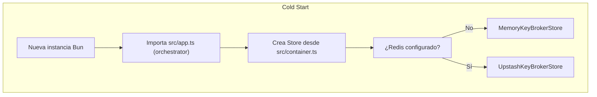

# Vercel Serverless y Routing

Este backend está diseñado para ejecutarse en **Vercel Serverless Functions** usando el runtime de Bun. Esta arquitectura implica ciertos patrones que pueden parecer redundantes a primera vista.

## El "Misterio" de los Archivos Idénticos en `api/`

Si revisas los archivos en `api/v1/`, todos parecen iguales:

```typescript
// api/v1/challenge.ts
import { app } from '../../src/app';
export default { fetch: app.fetch };

// api/v1/session/issue.ts
import { app } from '../../../src/app';
export default { fetch: app.fetch };

// api/v1/openrouter/lease.ts
import { app } from '../../../src/app';
export default { fetch: app.fetch };
```

**¿Por qué?**

Vercel convierte **cada archivo** en `api/` en una **función serverless independiente**. La estructura de carpetas determina las URLs:

```
api/v1/challenge.ts      →  GET/POST https://tu-app.vercel.app/api/v1/challenge
api/v1/session/issue.ts  →  POST https://tu-app.vercel.app/api/v1/session/issue
api/v1/openrouter/lease.ts → POST https://tu-app.vercel.app/api/v1/openrouter/lease
api/[...all].ts          →  CATCH-ALL para cualquier otra ruta
```

Elysia.js internamente tiene su **propio router**. Cada función serverless recibe la petición y la delega al router de Elysia, que decide qué handler ejecutar según el path y método HTTP.

## Diagrama de Routing



## Ventajas de este Patrón

1. **Reutilización de código:** Los entry points son puros; toda la lógica está en `src/routes/*` y `src/plugins/*`
2. **Modularidad:** Cada endpoint vive en su propio archivo (`src/routes/challenge.ts`, `src/routes/session.ts`, etc.)
3. **Rutas anidadas:** Elysia maneja `group()` y subrouters fácilmente (`src/app.ts:10-40`)
4. **Cold start optimizado:** Cada función puede escalar independientemente

## Desventajas

1. **Redundancia aparente:** Múltiples archivos con el mismo contenido
2. **No es un monolito tradicional:** Cada endpoint es potencialmente una función Lambda separada
3. **Configuración de `vercel.json` requerida:**

```json
// vercel.json
{
  "functions": {
    "api/**/*.ts": {
      "maxDuration": 60
    }
  },
  "crons": [
    {
      "path": "/api/v1/cron/reconcile",
      "schedule": "0 3 * * *"
    }
  ]
}
```

**Referencia:** `vercel.json`

## Cold Starts y Estado

Las funciones serverless son **stateless**: cada invocación puede correr en una instancia diferente.

**Implicación:** Si usas `MemoryKeyBrokerStore` (`src/services/store.ts:33`), los datos se pierden entre invocaciones. Por eso en producción se usa **Upstash Redis** (`src/services/upstashStore.ts:39`).

**Selector de store:** `src/services/storeFactory.ts:6-16`



## Configuración Relevante

```bash
# Vercel / Serverless
NODE_ENV=production
API_PREFIX=/api/v1

# Redis obligatorio en producción
UPSTASH_REDIS_REST_URL=https://...upstash.io
UPSTASH_REDIS_REST_TOKEN=AY...-
```

## Referencias

| Concepto | Archivo | Líneas |
|----------|---------|--------|
| Entry point catch-all | `api/[...all].ts` | 1-6 |
| Orchestrator Elysia | `src/app.ts` | 1-28 |
| Rutas modulares | `src/routes/*.ts` | — |
| Helpers reutilizables | `src/plugins/*.ts` | — |
| Instancias compartidas | `src/container.ts` | 1-14 |
| Factory de stores | `src/services/storeFactory.ts` | 6-16 |
| Config serverless | `vercel.json` | — |
