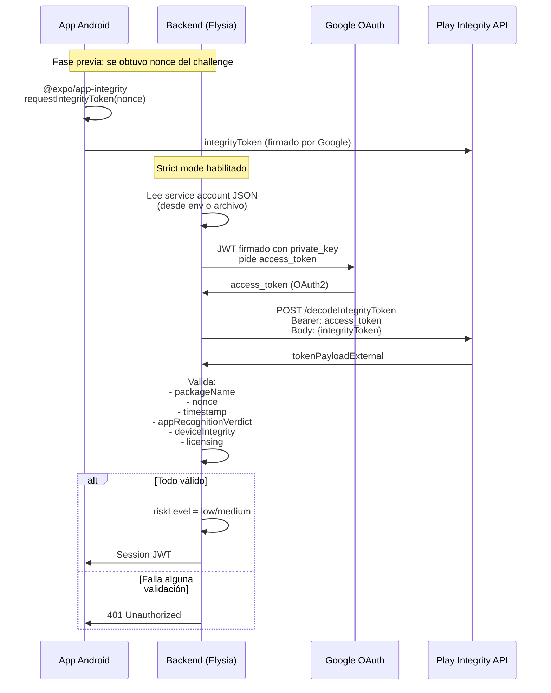
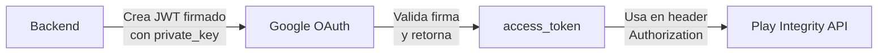

# Integración con Google Play Integrity API

La atestación (attestation) es el mecanismo que permite al backend verificar que la app Android es legítima, no ha sido modificada y corre en un dispositivo confiable.

## ¿Qué es Play Integrity?

Google Play Integrity API genera un **token criptográfico firmado por Google** que certifica:
- La app proviene de Google Play (no es un APK modificado)
- El dispositivo pasa ciertos checks de integridad
- El nonce (challenge) coincide con la solicitud

## Diagrama de Flujo



## Configuración de Service Account

El backend necesita una **cuenta de servicio de Google Cloud** con permisos para Play Integrity API.

### Variables de Entorno

```bash
# Obligatorio
PLAY_INTEGRITY_PACKAGE_NAME=com.tuapp.android

# Una de estas dos
PLAY_INTEGRITY_SERVICE_ACCOUNT_JSON={"client_email":"...","private_key":"..."}
PLAY_INTEGRITY_SERVICE_ACCOUNT_JSON_PATH=./credenciales/play-integrity.json

# Opcional (default: MEETS_DEVICE_INTEGRITY,MEETS_STRONG_INTEGRITY)
PLAY_INTEGRITY_ALLOWED_DEVICE_VERDICTS=MEETS_DEVICE_INTEGRITY,MEETS_STRONG_INTEGRITY

# Opcional
PLAY_INTEGRITY_REQUIRE_LICENSED=true
PLAY_INTEGRITY_MAX_TOKEN_AGE_MS=120000
PLAY_INTEGRITY_MAX_CLOCK_SKEW_MS=30000
```

### Creación de Service Account

1. Google Cloud Console → IAM → Service Accounts
2. Crear cuenta con rol "Play Integrity API User"
3. Generar clave JSON
4. Descargar y guardar como variable de entorno o archivo

## Flujo de Autenticación con Google (OAuth2)

El backend no usa una API key estática. En su lugar, implementa **OAuth2 JWT**:



**Implementación:**

1. **Lee y parsea el service account** (`src/services/attestation.ts:123-204`)
2. **Genera un JWT de assertion** con `jose` (`src/services/attestation.ts:206-255`)
3. **Intercambia por access_token** via `grant_type=urn:ietf:params:oauth:grant-type:jwt-bearer`
4. **Cachea el token** hasta que falte 1 minuto para expirar (`src/services/attestation.ts:257-271`)

## Veredictos Verificados

El backend valida múltiples campos del payload decodificado:

| Campo | Validación | Archivo |
|-------|-----------|---------|
| `requestPackageName` | Debe coincidir con `PLAY_INTEGRITY_PACKAGE_NAME` | `attestation.ts:399-405` |
| `requestHash` / `nonce` | Debe coincidir con el challenge original | `attestation.ts:407-414` |
| `timestampMillis` | No puede ser muy viejo ni del futuro | `attestation.ts:416-440` |
| `appRecognitionVerdict` | Debe ser `PLAY_RECOGNIZED` | `attestation.ts:442-449` |
| `deviceRecognitionVerdict` | Debe incluir al menos un veredicto permitido | `attestation.ts:451-459` |
| `appLicensingVerdict` | Si `requireLicensed=true`, debe ser `LICENSED` | `attestation.ts:461-468` |

### Veredictos de Dispositivo Permitidos

```typescript
// Valores posibles (de menos a más estricto)
'MEETS_BASIC_INTEGRITY'      // Dispositivo no rooteado (básico)
'MEETS_DEVICE_INTEGRITY'     // Dispositivo certificado por Google
'MEETS_STRONG_INTEGRITY'     // Dispositivo con hardware seguro (TEE)
'MEETS_VIRTUAL_INTEGRITY'    // Emulador/perfil de trabajo permitido
```

**Default:** `MEETS_DEVICE_INTEGRITY,MEETS_STRONG_INTEGRITY`

**Nivel de riesgo asignado:**
- `MEETS_STRONG_INTEGRITY` → `riskLevel: low`
- Otros veredictos válidos → `riskLevel: medium`
- Si es testing response → sube a `medium`

## Modo No-Estricto (Desarrollo)

```bash
ENABLE_STRICT_ATTESTATION=false
```

En este modo, el backend **ignora completamente** el token de attestation y asigna `riskLevel: low`. Útil para desarrollo local o emuladores sin Play Store.

**Referencia:** `src/services/attestation.ts:526-532`

## Cliente Android

La app usa `@expo/app-integrity` para solicitar el token:

```typescript
// context_android/AppIntegrityService.ts
import * as AppIntegrity from '@expo/app-integrity';

// 1. Preparar provider (una vez)
await AppIntegrity.prepareIntegrityTokenProviderAsync(cloudProjectNumber);

// 2. Solicitar token con el nonce del challenge
const token = await AppIntegrity.requestIntegrityCheckAsync(nonce);
```

**Nota:** El `cloudProjectNumber` es el número de proyecto de Google Cloud donde configuraste Play Integrity.

## Referencias

| Concepto | Archivo | Líneas |
|----------|---------|--------|
| Entry point verificación | `src/services/attestation.ts` | 515-547 |
| Verificación Android completa | `src/services/attestation.ts` | 324-482 |
| Lectura service account | `src/services/attestation.ts` | 123-204 |
| OAuth2 JWT | `src/services/attestation.ts` | 206-271 |
| Decode integrity token | `src/services/attestation.ts` | 273-308 |
| Cache de tokens | `src/services/attestation.ts` | 86-100 |
| Cliente Android | `context_android/AppIntegrityService.ts` | 72-93 |
