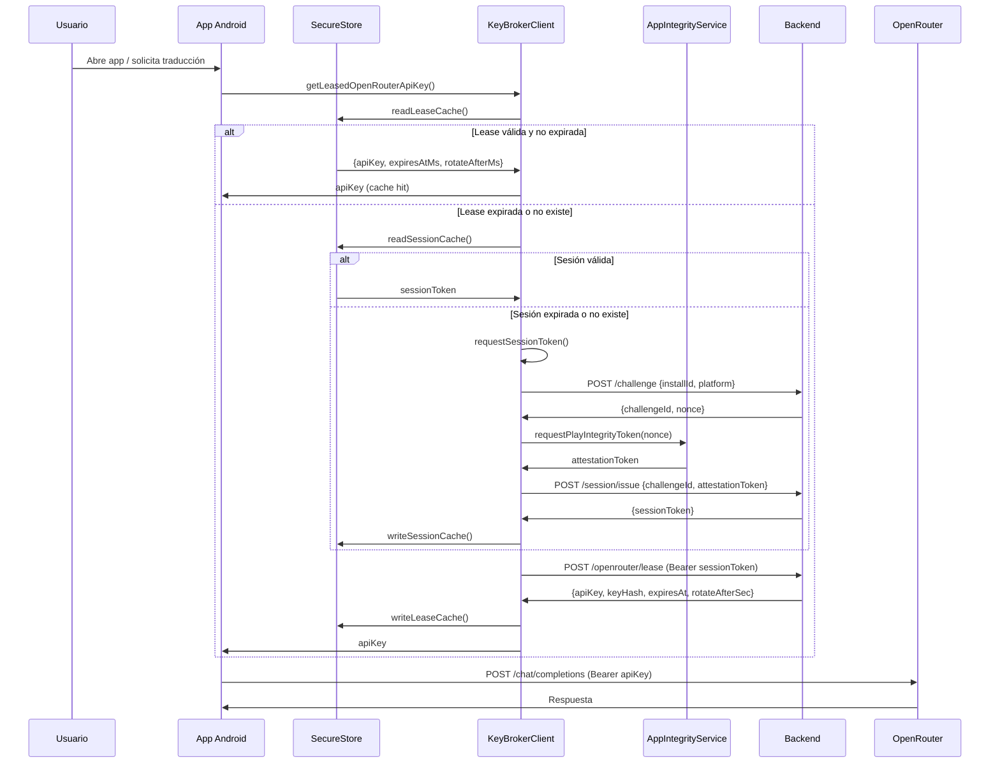

# App Android: Cliente del Backend

La aplicación Android interactúa con el backend en tres momentos: obtener un challenge, intercambiarlo por una sesión, y leasear una key de OpenRouter. Todo el flujo está encapsulado en `KeyBrokerClient.ts`.

## Diagrama de Secuencia (Vista Cliente)



## Componentes del Cliente

### 1. AppIntegrityService (`context_android/AppIntegrityService.ts`)

Encapsula la interacción con `@expo/app-integrity`:

```typescript
// 1. Preparar el provider (una sola vez)
await warmUpAppIntegrity();

// 2. Solicitar token con el nonce del challenge
const token = await requestPlayIntegrityToken(nonce);
```

**Características:**
- **Lazy initialization:** Prepara el provider solo cuando se necesita
- **Retry automático:** Si falla con `ERR_APP_INTEGRITY_PROVIDER_INVALID`, reintenta preparar y solicitar
- **Solo Android:** En iOS lanza error o usa token de debug

**Configuración requerida:**
```bash
EXPO_PUBLIC_PLAY_INTEGRITY_CLOUD_PROJECT_NUMBER=113784160464
```

### 2. KeyBrokerClient (`context_android/KeyBrokerClient.ts`)

Cliente HTTP que gestiona todo el ciclo de vida:

#### Generación de installId

```typescript
// createInstallId (línea 126-130)
const installId = `r2p-${Date.now()}-${random1}${random2}`;
```

Se almacena en `expo-secure-store` bajo la key `key-broker.install-id` y persiste entre sesiones.

#### Cacheo en SecureStore

| Tipo | Key | Contenido |
|------|-----|-----------|
| installId | `key-broker.install-id` | ID único persistente |
| session | `key-broker.session` | `{sessionToken, expiresAtMs}` |
| lease | `key-broker.lease` | `{apiKey, keyHash, expiresAtMs, rotateAfterMs}` |

**TTL local:**
- **Session:** `expiresAtMs - 30s` (margen de refresh)
- **Lease:** `min(expiresAtMs - 60s, rotateAfterMs)` (margen de expiry)

#### Lógica de Refresh

```typescript
// getLeasedOpenRouterApiKey (línea 320-346)
const usableUntil = Math.min(
  cachedLease.expiresAtMs - LEASE_EXPIRY_MARGIN_MS,    // 60s antes de expirar
  cachedLease.rotateAfterMs                            // o tiempo de rotación
);

if (usableUntil > Date.now()) {
  return cachedLease.apiKey;  // Cache hit
}

// Cache miss → solicitar nueva lease
const leaseReason = cachedLease ? 'refresh' : 'bootstrap';
```

#### Manejo de Errores

El cliente mapea errores HTTP del backend a mensajes amigables:

| Código HTTP | Mensaje al usuario |
|------------|-------------------|
| 404 | "El backend no encontró la ruta solicitada" |
| 429 | "Demasiadas solicitudes seguidas" |
| 401/403 | "No se pudo autorizar la sesión de traducción" |
| 503 | "El backend de autorización no está disponible" |

**Retry en 401/403:** Si el lease falla por auth, refresca la sesión automáticamente e intenta una vez más (`retryOnAuthError`).

## Flujo de Datos Detallado

### Paso 1: Obtener Challenge

```typescript
// KeyBrokerClient.ts:235-242
const challenge = await getJson<ChallengeResponse>('/challenge', {
  method: 'POST',
  body: JSON.stringify({
    installId,
    platform: 'android',
    appVersion: '1.0.0',
  }),
});
// → {challengeId, nonce, expiresInSec}
```

### Paso 2: Obtener Attestation Token

```typescript
// KeyBrokerClient.ts:244
const attestationToken = await createAttestationToken(installId, challenge.nonce);

// Si Android:
await requestPlayIntegrityToken(nonce);

// Si iOS (debug):
`debug.ios.${installId.slice(0,12)}.${nonce.slice(0,12)}.${Date.now()}`
```

### Paso 3: Intercambiar por Sesión

```typescript
// KeyBrokerClient.ts:246-254
const session = await getJson<SessionIssueResponse>('/session/issue', {
  method: 'POST',
  body: JSON.stringify({
    challengeId: challenge.challengeId,
    installId,
    platform: 'android',
    attestationToken,
  }),
});
// → {sessionToken, expiresInSec, riskLevel}
```

### Paso 4: Leasear Key

```typescript
// KeyBrokerClient.ts:285-294
const response = await getJson<LeaseResponse>('/openrouter/lease', {
  method: 'POST',
  headers: { Authorization: `Bearer ${sessionToken}` },
  body: JSON.stringify({ installId, reason: 'bootstrap' }),
});
// → {apiKey, keyHash, expiresAt, rotateAfterSec}
```

### Paso 5: Usar Key Directamente

```typescript
// La app usa la apiKey directamente
const response = await fetch('https://openrouter.ai/api/v1/chat/completions', {
  method: 'POST',
  headers: {
    'Authorization': `Bearer ${apiKey}`,
    'Content-Type': 'application/json',
  },
  body: JSON.stringify({ model: 'gpt-4', messages: [...] }),
});
```

## Configuración del Cliente

```bash
# Obligatorio
EXPO_PUBLIC_KEY_BROKER_URL=https://raventopandas.vercel.app
EXPO_PUBLIC_KEY_BROKER_API_PREFIX=/api/v1

# Para Play Integrity (Android)
EXPO_PUBLIC_PLAY_INTEGRITY_CLOUD_PROJECT_NUMBER=113784160464
```

## Referencias

| Concepto | Archivo | Líneas |
|----------|---------|--------|
| Cliente completo | `context_android/KeyBrokerClient.ts` | 1-374 |
| Servicio de attestation | `context_android/AppIntegrityService.ts` | 1-94 |
| Creación de installId | `context_android/KeyBrokerClient.ts` | 126-130 |
| Cacheo de session | `context_android/KeyBrokerClient.ts` | 202-213 |
| Cacheo de lease | `context_android/KeyBrokerClient.ts` | 215-229 |
| Request session | `context_android/KeyBrokerClient.ts` | 231-263 |
| Request lease | `context_android/KeyBrokerClient.ts` | 277-318 |
| Uso de key | `context_android/KeyBrokerClient.ts` | 320-346 |
| Revocación | `context_android/KeyBrokerClient.ts` | 348-367 |
| Manejo de errores | `context_android/KeyBrokerClient.ts` | 72-120 |
