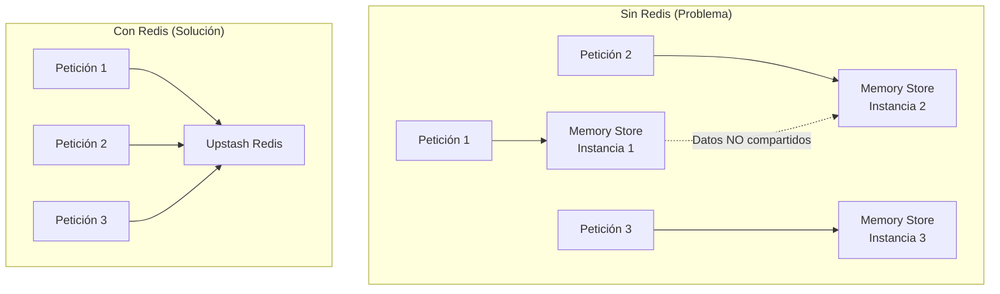
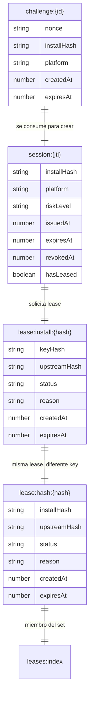

# Almacenamiento con Redis (Upstash)

El backend soporta dos modos de almacenamiento: **en memoria** (desarrollo) y **Redis** (producción). Este documento explica la implementación Redis usando Upstash.

## ¿Por qué Redis?

Las funciones serverless de Vercel son **efímeras**: cada invocación puede ejecutarse en una instancia diferente con memoria limpia. Si usamos almacenamiento en memoria, los datos no se comparten entre peticiones.



## Selector de Store

El backend detecta automáticamente si Redis está configurado:

```typescript
// src/services/storeFactory.ts:6-16
export const createStore = (cfg: AppConfig): KeyBrokerStore => {
  const upstashUrl = cfg.storage.upstashUrl.trim();
  const upstashToken = cfg.storage.upstashToken.trim();

  if (upstashUrl && upstashToken) {
    console.log('[key-leasing] using Upstash Redis store');
    return new UpstashKeyBrokerStore(upstashUrl, upstashToken);
  }

  console.warn('[key-leasing] using in-memory store (not recommended for production)');
  return new MemoryKeyBrokerStore();
};
```

## Estructura de Datos en Redis

### Esquema de Keys

| Prefijo | Ejemplo | Propósito |
|---------|---------|-----------|
| `challenge:` | `challenge:uuid-123` | Challenge temporal (TTL: 60s) |
| `session:` | `session:uuid-456` | Sesión JWT (TTL: 15min) |
| `lease:install:` | `lease:install:hash-abc` | Lease por installHash |
| `lease:hash:` | `lease:hash:hash-def` | Lease por keyHash |
| `rl:` | `rl:challenge:ip:hash` | Rate limiting |
| `leases:index` | `leases:index` | Set de todos los keyHash |

### Diagrama de Relaciones



## Operaciones Principales

### 1. Challenge (`createChallenge` / `takeChallenge`)

```typescript
// src/services/upstashStore.ts:70-81
async createChallenge(record: ChallengeRecord): Promise<void> {
  await this.redis.set(`challenge:${record.id}`, JSON.stringify(record), {
    ex: toSecondsUntil(record.expiresAt),  // TTL automático
  });
}

async takeChallenge(challengeId: string): Promise<ChallengeRecord | null> {
  const key = `challenge:${challengeId}`;
  const raw = await this.redis.get(key);
  await this.redis.del(key);  // Consume (one-time)
  return decodeJson(raw);
}
```

**Ventaja:** El TTL de Redis elimina challenges expirados automáticamente. No necesita cleanup.

### 2. Session (`saveSession` / `getSession`)

```typescript
// src/services/upstashStore.ts:83-102
async saveSession(record: SessionRecord): Promise<void> {
  await this.redis.set(`session:${record.jti}`, JSON.stringify(record), {
    ex: toSecondsUntil(record.expiresAt),
  });
}

async getSession(jti: string): Promise<SessionRecord | null> {
  const raw = await this.redis.get(`session:${jti}`);
  const session = decodeJson<SessionRecord>(raw);
  if (!session) return null;

  // Doble validación: TTL de Redis + lógica de negocio
  if (session.expiresAt <= Date.now()) {
    await this.redis.del(`session:${jti}`);
    return null;
  }
  return session;
}
```

### 3. Lease (`putLease` / `getLeaseByInstall`)

Las leases se almacenan **dos veces** para permitir búsquedas bidireccionales:

```typescript
// src/services/upstashStore.ts:134-142
async putLease(record: LeaseRecord): Promise<void> {
  const currentLease = await this.getLeaseByInstall(record.installHash);
  if (currentLease && currentLease.keyHash !== record.keyHash) {
    // Limpia lease anterior
    await this.redis.del(`lease:hash:${currentLease.keyHash}`);
    await this.redis.srem('leases:index', currentLease.keyHash);
  }

  await this.persistLease(record);
}
```

```typescript
// src/services/upstashStore.ts:120-132
private async persistLease(record: LeaseRecord): Promise<void> {
  const leaseTtl = toSecondsUntil(record.expiresAt, 60) + 86400;  // TTL + 1 día extra

  await this.redis.set(`lease:install:${record.installHash}`, JSON.stringify(record), { ex: leaseTtl });
  await this.redis.set(`lease:hash:${record.keyHash}`, JSON.stringify(record), { ex: leaseTtl });
  await this.redis.sadd('leases:index', record.keyHash);
}
```

**TTL extendido:** Las leases tienen TTL = `expiresAt + 1 día` para permitir auditoría después de la expiración.

### 4. Rate Limiting

```typescript
// src/services/upstashStore.ts:223-242
async checkRateLimit(bucketKey: string, maxCount: number, windowSeconds: number): Promise<RateLimitDecision> {
  const key = `rl:${bucketKey}`;
  const currentCount = Number(await this.redis.incr(key));

  if (currentCount === 1) {
    await this.redis.expire(key, windowSeconds);  // Setea TTL solo en el primer incremento
  }

  const ttlSeconds = Number(await this.redis.ttl(key));
  return {
    allowed: currentCount <= maxCount,
    remaining: Math.max(0, maxCount - currentCount),
    resetAt: Date.now() + ttlSeconds * 1000,
  };
}
```

**Algoritmo:** Contador simple con `INCR` + `EXPIRE`. Si la key es nueva (count === 1), setea el TTL.

### 5. Listado de Leases (`listLeases`)

```typescript
// src/services/upstashStore.ts:212-227
async listLeases(): Promise<LeaseRecord[]> {
  const hashesRaw = await this.redis.smembers(LEASES_INDEX_KEY);
  const hashes = Array.isArray(hashesRaw) ? hashesRaw.map((value) => String(value)) : [];

  const leases: LeaseRecord[] = [];
  for (const hash of hashes) {
    const lease = await this.getLeaseByKeyHash(hash);
    if (!lease) {
      await this.redis.srem(LEASES_INDEX_KEY, hash);  // Limpia huérfanos
    } else {
      leases.push(lease);
    }
  }
  return leases;
}
```

**Importante:** El set `leases:index` puede tener elementos huérfanos (keys que expiraron en Redis pero no fueron removidos del set). El método los limpia automáticamente.

### 6. Health Check (`ping`)

El store expone un método `ping()` para verificar conectividad:

```typescript
// src/services/upstashStore.ts
async ping(): Promise<boolean> {
  const response = await this.redis.ping();
  return response === 'PONG';
}
```

En `MemoryKeyBrokerStore`, `ping()` siempre retorna `true` (la instancia en memoria siempre está disponible si el proceso corre).

Este método se usa en el endpoint `/health` para monitorear la salud de Redis.

**Referencia:** `src/routes/health.ts:5-25`

### 7. Cleanup (`cleanupExpired`)

```typescript
// src/services/upstashStore.ts:255-273
async cleanupExpired(now = Date.now()): Promise<CleanupReport> {
  let leasesExpired = 0;
  const leases = await this.listLeases();

  for (const lease of leases) {
    if (lease.status === 'active' && lease.expiresAt <= now) {
      await this.markLeaseExpired(lease.keyHash);
      leasesExpired += 1;
    }
  }

  return {
    challengesDeleted: 0,   // Redis TTL los elimina automáticamente
    sessionsDeleted: 0,     // Redis TTL los elimina automáticamente
    rateBucketsDeleted: 0,  // Redis TTL los elimina automáticamente
    leasesExpired,
  };
}
```

**Nota:** En Redis, challenges, sessions y rate buckets usan **TTL nativo**, por lo que no requieren cleanup manual. Solo las leases necesitan verificación por el campo `expiresAt`.

## Comparativa: Memory vs Redis

| Característica | Memory Store | Redis (Upstash) |
|---------------|-------------|-----------------|
| Persistencia | No (pierde datos al reiniciar) | Sí |
| Compartido entre instancias | No | Sí |
| TTL automático | Implementado manualmente (cleanup cron) | Nativo de Redis |
| Escalabilidad | 1 instancia | Ilimitado |
| Latencia | ~0ms | ~10-50ms |
| Costo | Gratis | Gratis hasta cierto límite |
| Ideal para | Desarrollo local | Producción en Vercel |

## Configuración

```bash
# Upstash Redis (obligatorio en producción)
UPSTASH_REDIS_REST_URL=https://...upstash.io
UPSTASH_REDIS_REST_TOKEN=AY...-
```

Para obtener estas credenciales:
1. Crear cuenta en [Upstash](https://upstash.com/)
2. Crear un database Redis
3. Copiar la REST URL y el token

## Referencias

| Concepto | Archivo | Líneas |
|----------|---------|--------|
| Interface del store | `src/services/store.ts` | 14-32 |
| Implementación memory | `src/services/store.ts` | 34-240 |
| Implementación Redis | `src/services/upstashStore.ts` | 39-274 |
| Factory/selector | `src/services/storeFactory.ts` | 6-17 |
| Health check ping | `src/services/upstashStore.ts` | 250-253 |
| Endpoint health | `src/routes/health.ts` | 113-115 |
| OpenRouter client | `src/services/openrouter.ts` | 66-158 |
| Configuración | `src/config.ts` | 170-173 |
